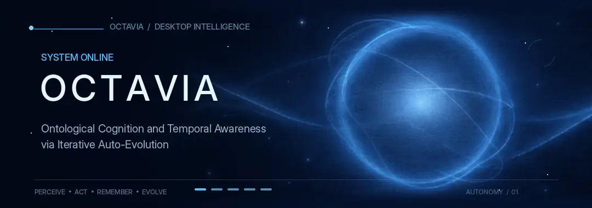
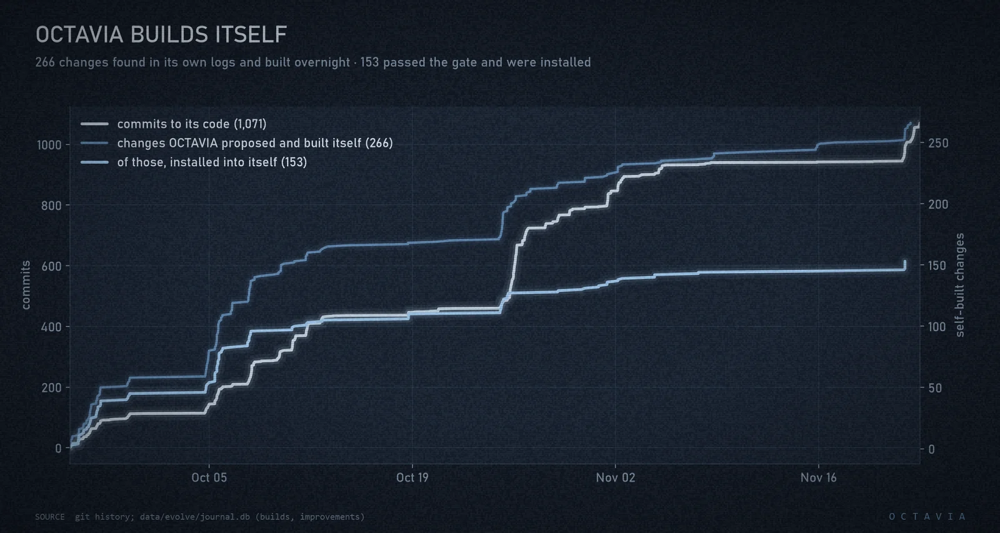
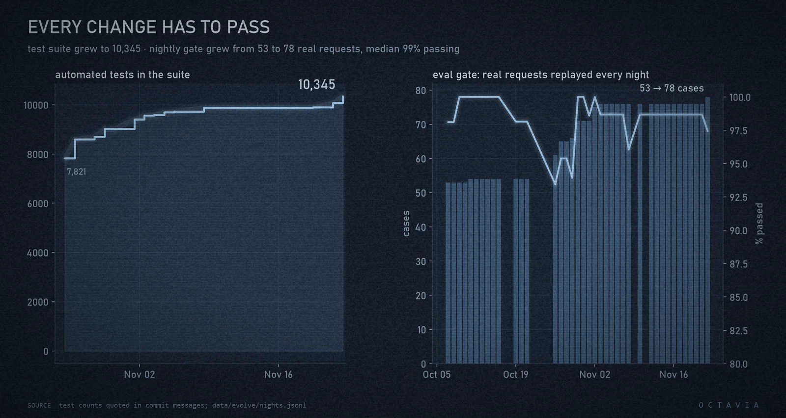
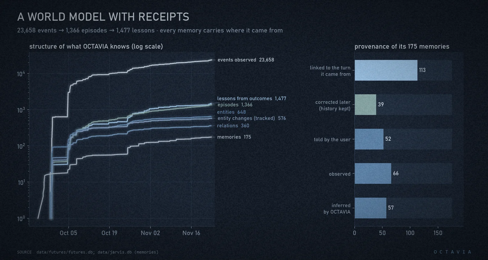
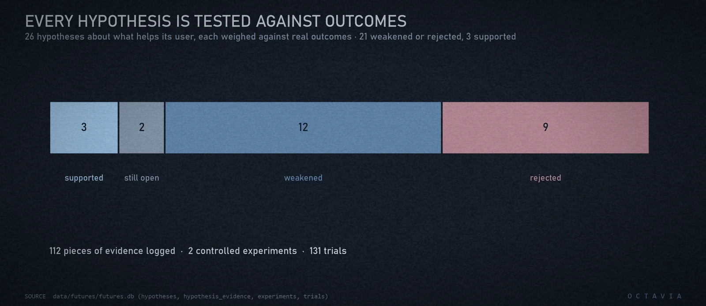

  
  
  
  
  
  
  

# OCTAVIA

**O**ntological **C**ognition and **T**emporal **A**wareness **V**ia **I**terative **A**uto-Evolution.

A voice-first assistant for Windows. Say "OCTAVIA", talk naturally, and it answers out loud. It can use your PC,
look at your screen, remember things you tell it, keep your to-dos and coursework in view, and be interrupted
mid-sentence. Its ears run on your PC: your microphone audio never leaves it, only the words it heard go to the
model that thinks for it.

## Growth

On the maintainer's PC, OCTAVIA improves itself: each night it reads its own logs, builds the fixes it finds, and
installs only what passes its tests and a replay of real requests. These charts are drawn from that install;
every number comes from its records, nothing is simulated.

## What you need

- Windows 10 or 11, a microphone and speakers or headphones
- [uv](https://docs.astral.sh/uv/) (the installer offers to get it)
- A way for it to think: **your own** Claude account (Pro or Max) or an Anthropic API key. Nothing runs on anyone
  else's account.
- Optional: a [Fish Audio](https://fish.audio) API key for its voice. Without one it speaks with Windows' own voice,
  or with a voice made on your GPU if you have one.
- Optional: a GPU. Everything works on the CPU; a GPU only adds the local voice and a local model.

## Install

Download **`OCTAVIA-Setup.cmd`** from the [latest release](https://github.com/Xitral/octavia/releases/latest) and
double-click it. Windows may say it protected your PC: click **More info**, then **Run anyway**. No administrator
rights are needed. If anything goes wrong, the window stays open and says what, and everything is logged to
`%TEMP%\OCTAVIA-Setup.log`.

It installs OCTAVIA to `%LOCALAPPDATA%\Programs\OCTAVIA`, adds it to the Start menu and to Windows' Installed apps,
downloads its speech models (about 1 GB, once), and opens the guided setup, where you form OCTAVIA step by step and
its orb wakes as you go:

1. **Its mind:** your own Claude account (signed in through the browser) or an Anthropic API key.
2. **Its ears:** your microphone and speakers.
3. **Its voice:** six voices to hear and pick from, made with your own Fish Audio key (there's a free tier), with
   the "console" effect by default. Without a key it speaks with Windows' own voice.
4. **Who it is:** its name, the word that wakes it, what it calls you.
5. **Home:** your town, for the weather, directions and maps.
6. **Its reach:** Discord (text and call it from your phone through your own bot), TickTick, Canvas, Gmail, and
   whether to share what it learns with the hivemind.
7. **This PC:** what it can run.

Run the setup again any time with `uv run octavia welcome --window` from its folder.

## Updates

When a new version is out, OCTAVIA says so once and its tray menu shows **Update OCTAVIA to ...**: one click, about
a minute, and it's back on the new version. Updates are signed by the maintainer and checked before anything is
applied. Nothing of yours is touched.

## Uninstall

Windows Settings, Apps, Installed apps, OCTAVIA, Uninstall. Your memories, settings and keys stay unless you tick
the box to delete them, so installing again later picks up where you left off.

## Your data

Everything OCTAVIA keeps (memories, notes, logs, screen history if you turn it on), your settings, your keys and the
speech models live in `%LOCALAPPDATA%\OCTAVIA`, on your PC, apart from the program, so updates and reinstalls never
touch them. None of it is ever sent anywhere except to the services you connect (the model, the voice, your
integrations).

## Talking to it from your phone (Discord)

Make your own Discord bot (the wizard walks you through it, and `docs/discord-bridge.md` has the details). It
answers only your account: DMs from anyone else are ignored, and on a voice call only your voice is decoded.

## License

[PolyForm Noncommercial 1.0.0](LICENSE.md): free to use, change and share for any noncommercial purpose. Selling
OCTAVIA, or building a paid product or service on it, needs the maintainer's permission.

Proposals sent through the hivemind (fixes, lessons, test cases) are contributions: by turning sharing on you agree
the maintainer may use, change, include and relicense them in OCTAVIA, under this license or any later one.
